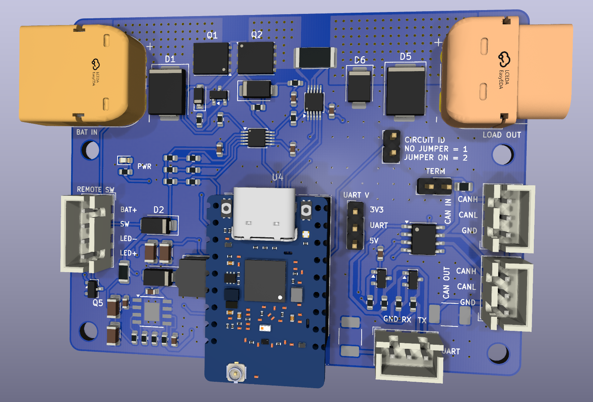
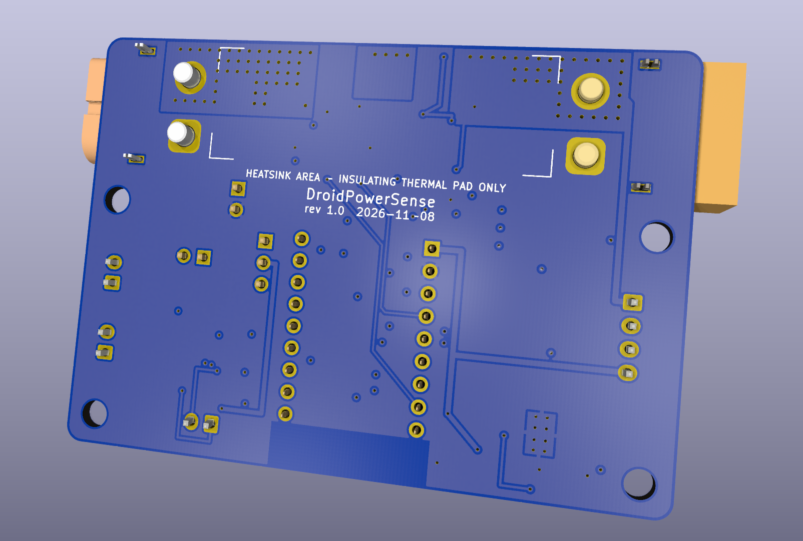

# DroidPowerSense

An inline battery power switch, protection and telemetry board for droid builds. It sits between the
battery and the rest of the droid, switches the main power from a small remote switch, protects the
droid's electronics, and reports battery voltage and current over CAN FD and UART.

<p align="center">
  
  
</p>

## What it does

- **Power switch with zero drain.** Back-to-back MOSFETs under an LM5060 controller switch up to
  30 A continuous (60 A peak). A small remote switch turns the droid on and off;
  with the switch off, the fitted battery draws nothing beyond semiconductor leakage (< 1 µA).
- **Works with common droid batteries:** 9-32 V, for example 12 V lead-acid, 18 V / 20 V Max
  power-tool packs, and 24 V LiPo / LiFePO4.
- **Protection:** reverse battery, input and output surge (TVS), motor flyback, under- and
  over-voltage cutoff, and an overcurrent / short-circuit trip. The turn-on is soft-started so large
  motor-controller capacitors don't cause a current spike.
- **Telemetry:** battery voltage (readable even with the load switched off), load voltage and
  current (±164 A range, 5 mA resolution), reported over **CAN FD** (daisy-chainable) and a
  level-shifted **UART** (3.3 V or 5 V).
- **Lit remote switches:** supports plain switches and switches with a built-in light that is on
  whenever the droid is on. Firmware can blink it.
- **Two-circuit droids:** a circuit ID jumper lets two boards (one per circuit) identify themselves.
- **Serviceable:** the ESP32-C5 module plugs into sockets and programs over its own USB-C.

## How it fits in a droid

```
Battery ── XT60 lead with in-line blade fuse (30 A) ─▶ BAT IN [ DroidPowerSense ] LOAD OUT ─▶ droid fuse box ── motor controllers / electronics
                                                          │      │     │
                                         remote switch ───┘      │     └── CAN FD in / out (daisy chain)
                                                                 └──────── UART (3.3 V or 5 V)
```

- **Use an XT60 battery lead with an in-line blade fuse** (a common off-the-shelf part) between the
  battery and BAT IN: **30 A** for most builds, 40 A at most. The board is an electronic circuit
  breaker, not a current limiter, so only a fuse clears a dead short quickly. Fused at the battery,
  everything after it is covered: the battery lead, the board, and the remote-switch lead.
- **Wire the remote switch with 22 AWG or heavier.** Its `BAT+` wire carries battery voltage, so a
  chafed lead must draw enough current to blow the battery fuse before the wire overheats; 26 AWG can
  melt first.
- A fuse box for the droid's branch circuits can go after LOAD OUT as usual.
- Up to **4.7 mF** of capacitance on LOAD OUT at 32 V (more at lower battery voltages).
- One board per power circuit.

## Specifications

| | |
|---|---|
| Input voltage | 9-32 V (hardware under-voltage cutoff ≈ 7.5 V, over-voltage cutoff ≈ 38 V) |
| Current | 30 A continuous, 60 A peak |
| Power connectors | XT60PW-M in (mates with the battery's female XT60), XT60PW-F out |
| Off-state drain | < 1 µA with the remote switch open |
| Current / voltage sensing | TI INA237 on a 1 mΩ shunt: ±164 A range, 5 mA resolution; also measures the LOAD OUT voltage |
| Battery voltage sensing | ESP32-C5 ADC through a ÷ 11 divider |
| MCU | Waveshare ESP32-C5-Zero-M (Wi-Fi 6, BLE 5, CAN FD), on 2.54 mm sockets |
| Comms | CAN FD (TI TCAN334G, 2 × 3-pin JST-XH with bus ground, jumper termination); UART (3-pin JST-XH with ground, 3.3 V / 5 V) |
| Board | 76 × 58 mm, 4 layers, 1.6 mm, 2 oz outer / 1 oz inner copper, components on one side |
| Mounting | 4 × M3 holes |

## Connectors and jumpers

Every connector has its pin functions printed on the board next to each pin.

| Ref | Silkscreen | Type | Pins / settings |
|---|---|---|---|
| J1 | BAT IN | XT60PW-M | + / − from the battery, through the in-line fused XT60 lead |
| J2 | LOAD OUT | XT60PW-F | + / − to the droid |
| J3 | REMOTE SW | JST-XH 4-pin | `BAT+`, `SW`, `LED-`, `LED+` (see below) |
| J5 / J6 | CAN IN / CAN OUT | JST-XH 3-pin | `GND`, `CANL`, `CANH`; wired in parallel, so IN and OUT are a cabling convention. `GND` is a bus ground reference: run it through every CAN cable |
| J8 | UART | JST-XH 3-pin | `GND`, `RX` (into the board), `TX` (out of the board). Connect `GND` to the other device's ground |
| J7 | TERM | 2-pin jumper | Fitted = 120 Ω CAN termination. Fit only on the boards at the two ends of the bus. |
| J9 | UART V | 3-pin jumper | `3V3`-`UART` = 3.3 V UART; `UART`-`5V` = 5 V UART |
| J4 | CIRCUIT ID | 2-pin jumper | No jumper = circuit 1, jumper on = circuit 2 |

The three jumper shunts (Würth 60900213421) are in the BOM.

The CAN and UART `GND` pins are signal references, not power returns: each goes to the board's
ground through a resettable fuse (PTC), so if a battery-negative lead comes off while a comms cable
is still plugged in, the fuse trips instead of the load current flowing through the thin comms wire.
Always connect battery negative through the XT60s.

### Wiring the remote switch (J3)

| J3 pin | Plain switch | Lit switch, 3-terminal (+ / ACC / GND) | Lit switch, separate LED terminals |
|---|---|---|---|
| `BAT+` | one side | + | one contact |
| `SW` | other side | ACC (output) | other contact |
| `LED-` | — | GND | LED − |
| `LED+` | — | — | LED + |

- **3-terminal lit switches** power their light from the battery, so buy one rated for your pack
  (12 V for lead-acid; 24 V or "12-24 V" for 18-24 V packs).
- **Switches with separate LED terminals:** buy the **5 V or 6 V** LED version. The board powers it
  from its own 5 V, so the same switch works on any battery.

## Before you power it up

- **Fuse the battery lead:** an XT60 lead with an in-line blade fuse (30 A, 40 A max) ahead of
  BAT IN, and 22 AWG or heavier for the remote-switch lead.
- **Heatsink (optional):** at 30 A continuous the power stage runs warm. The marked area on the back
  takes a small stick-on heatsink, but **only with an electrically insulating thermal pad**. Bare
  metal would short the power nets underneath and bypass the switch.
- **Secure the module** in a droid that vibrates: a dab of hot glue or a cable tie at the antenna end.
  It stands about 11 mm tall on its sockets.
- **Firmware is part of the protection.** Overcurrent cutoff between 30 A and the hardware trip
  point, and never cutting power while the motors are regenerating, are firmware's job; see
  [docs/firmware-requirements.md](docs/firmware-requirements.md).

## Project status

| Area | Status |
|---|---|
| Hardware design | Complete and reviewed: all design and layout checks pass, power stage verified in simulation |
| PCB | In progress: moved from 70 × 50 mm on 6 layers to 76 × 58 mm on 4 layers (cheaper to fab) with 3-pin CAN/UART connectors. Placed and poured; signal routing to redo by hand. [`PCB/production/`](PCB/production/) still holds the superseded 6-layer v1.0 files, and the renders above show that board. |
| Firmware | Not started (Rust on the ESP32-C5). Requirements captured in [docs/firmware-requirements.md](docs/firmware-requirements.md). |
| Bench testing | Not started. The first-board checklist is in [PCB/README.md](PCB/README.md#bench-checklist-first-board). |

## Repository layout

| Path | Contents |
|---|---|
| [`PCB/README.md`](PCB/README.md) | Hardware design: requirements, circuit, decisions, layout, accepted risks and bench checklist |
| [`PCB/stackup/`](PCB/stackup/) | The electrical design in [Stackup](https://github.com/stackup-eda/stackup) KDL (`board.kdl`, `parts.kdl`); there are no KiCad schematics |
| `PCB/DroidPowerSense.kicad_pcb` | The KiCad 10 board, synced from the Stackup design |
| [`PCB/production/`](PCB/production/) | Fab files: Gerbers and drills, purchasing BOM, placement file |
| [`PCB/datasheets/`](PCB/datasheets/) | Manufacturer datasheets, with source and hash in `manifest.json` |
| [`PCB/libraries/`](PCB/libraries/) | Custom footprints and 3D models (XT60PW, socketed ESP32 module) |
| [`scripts/spice/`](scripts/spice/README.md) | ngspice simulations of the power switch and UART level shifters, and an SOA checker |
| [`docs/firmware-requirements.md`](docs/firmware-requirements.md) | What the firmware must do for the hardware, pin map and peripheral setup |
| `ci/` | The pinned Stackup CLI and the PCB sync check used by CI |
| `src/` | Firmware (Rust, ESP32-C5), not started yet |

## Working on the design

The design is checked with the Cargo-pinned Stackup CLI and KiCad 10 (`kicad-cli`):

```sh
cargo run --locked --manifest-path ci/stackup/Cargo.toml -- check PCB/stackup/board.kdl --locked
python3 scripts/spice/power_switch_sim.py     # power switch, all scenarios
python3 scripts/spice/uart_shifter_sim.py     # UART level shifters
python3 scripts/spice/test_soa.py             # SOA checker unit tests
```

- After any change to the KDL, sync the PCB from Stackup (see [PCB/README.md](PCB/README.md)) and
  commit the board with the KDL. CI fails if they drift apart.
- Refill the pours and regenerate `PCB/production/` after any board change; the commands are in
  [PCB/README.md](PCB/README.md).
- Changes go through pull requests; history is kept linear (rebase merges).

## Ordering

- **Fab:** 4 layers, 1.6 mm, **2 oz outer / 1 oz inner** copper; minimum track and spacing 0.2 mm.
  Don't order it with 1 oz outer copper: the 30 A path needs the 2 oz.
- **Parts:** the BOM lists Mouser and DigiKey numbers (LCSC where available). The XT60 connectors
  (Amass) and the ESP32-C5-Zero-M module (Waveshare) come from their own channels.
- **Hand assembly:** the connectors, jumpers, module sockets and module are through-hole and
  hand-soldered; the placement file lists only the 69 surface-mount parts.
